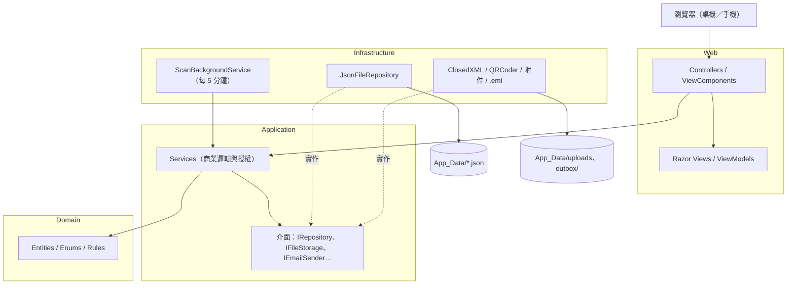
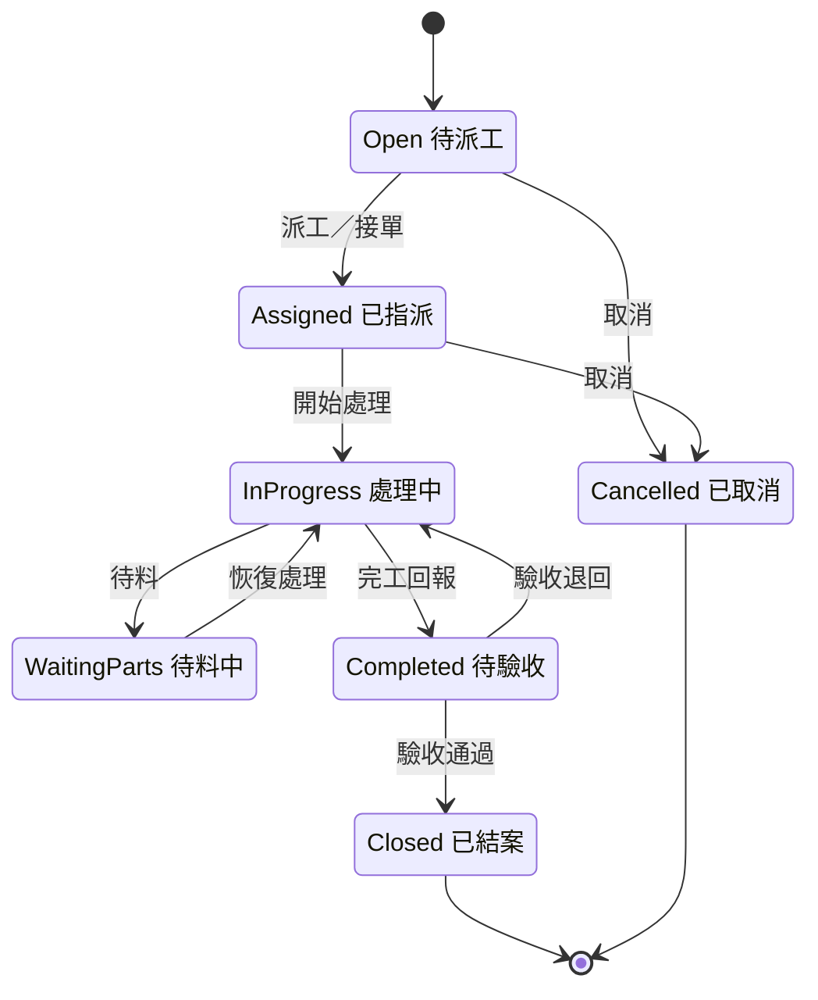

# AssetCare 設備資產報修與保養管理系統

公司內部使用的設備資產、報修工單、預防保養與零件管理系統。ASP.NET Core MVC（.NET 10），資料以 JSON 檔保存，不需資料庫，可離線執行，桌機與手機（掃 QR Code 報修、現場回報）皆可使用。

## 功能清單

| 模組 | 內容 |
|---|---|
| 資產管理 | 清單搜尋／篩選／排序、詳情（保固、折舊、維修歷史、附件）、新增編輯、轉移、報廢、類別與地點、QR Code 標籤、Excel 匯入匯出 |
| 報修與工單 | 掃碼報修、照片、派工／改派／接單、處理／待料／完工、驗收與退回、取消、留言、重複報修提示、外送維修 |
| 預防保養 | 保養計畫（日／週／月／季／年／使用量）、自動產生工單、檢查清單、保養行事曆、逾期提醒 |
| 零件與廠商 | 庫存、入庫／領用／盤點、安全庫存警示、異動紀錄、廠商資料 |
| 通知 | 站內通知中心、Email 模擬（寫入 `outbox/` 的 `.eml`）、SLA 逾時與到期提醒 |
| 儀表板與報表 | 依角色的首頁、趨勢／類別／部門／成本圖表、SLA 達成率、MTBF；工單、資產、保養、零件異動、維修成本 Excel |
| 系統管理 | 使用者與角色、SLA 與系統參數、稽核紀錄查詢匯出、登入鎖定與頻率限制、健康檢查（`/health`） |

## 截圖

| 畫面 | 截圖 |
|---|---|
| 主管儀表板 | _（待補：`docs/screenshots/dashboard.png`）_ |
| 工單詳情（手機） | _（待補：`docs/screenshots/workorder-mobile.png`）_ |
| 保養行事曆 | _（待補：`docs/screenshots/calendar.png`）_ |
| 掃碼報修（手機） | _（待補：`docs/screenshots/scan.png`）_ |

## 啟動方式

需安裝 .NET 10 SDK，在方案根目錄執行後開啟 <https://localhost:7171>：

```powershell
dotnet dev-certs https --trust
```

```powershell
dotnet run --project AssetCare --launch-profile https
```

首次啟動會把 `AssetCare/SeedData` 複製到 `AssetCare/App_Data`。要回到範例資料，用管理員在「系統管理」按「重置為範例資料」（僅 Development）。範例日期是產生當下的快照，需要新鮮資料時先執行 `dotnet run --project AssetCare -- --generate-seed` 再重置。

## Demo 帳號

所有範例帳號使用同一組密碼：`Demo@2026!`（定義於 `AssetCare/SeedData/_source/catalog.json` 的 `demoPassword`）。**僅供展示，正式使用前必須更換。**

| 角色 | 帳號 | 姓名 |
|---|---|---|
| 系統管理員 | `admin` | 陳柏宇 |
| 主管 | `lin.meiling` | 林美玲 |
| 主管 | `wang.jianhong` | 王建宏 |
| 技術員 | `chang.zhiwei` | 張志偉 |
| 技術員 | `huang.junjie` | 黃俊傑 |
| 技術員 | `liu.yating` | 劉雅婷 |
| 申請人 | `wu.shufen` | 吳淑芬 |
| 申請人 | `tsai.minghui` | 蔡明輝 |
| 申請人 | `hsu.peiyu` | 許珮瑜 |
| 申請人 | `cheng.wenxiong` | 鄭文雄（已停用，無法登入） |

開發環境也可用右上角「切換使用者」免密碼切換身分（預設僅限本機連線）。

## 手機測試方式

相機掃描需要 HTTPS（或 localhost）。

1. 電腦與手機連同一個網段，執行：

   ```powershell
   dotnet run --project AssetCare --launch-profile lan-https
   ```

2. 用 `ipconfig` 查電腦的區網 IP，手機瀏覽器開 `https://電腦IP:7171`。
3. 開發憑證只簽給 `localhost`，手機會出現憑證警告，確認是自己的電腦後選擇繼續前往。連不上時，檢查 Windows 防火牆是否允許 TCP 7171。
4. 要讓 QR 標籤指向區網網址，將 `appsettings.json` 的 `App:PublicBaseUrl` 設為 `https://電腦IP:7171` 後重新列印標籤。

相機仍無法開啟時，掃碼頁可改用「拍照或選擇照片辨識」或手動輸入資產編號。手機上若需要「切換使用者」，要把 `DevTools:AllowRemoteQuickSwitch` 設為 `true`；注意這會讓同網段任何人都能切成管理員，測完請改回。

## 架構



背景作業依序執行：SLA 逾時掃描 → 保養工單產生 → 保固與保養到期提醒。

## 工單狀態



保養工單走相同流程；有指派技術員時，產生後直接進入「已指派」。

## JSON 欄位說明

每個實體一個檔案（實體名複數），欄位為 camelCase，列舉存字串。時間點欄位（`…At`）為 UTC，日期欄位（`…Date`）為台北日期。

共同欄位：`id`、`version`（樂觀並行控制）、`createdAt`、`updatedAt`。

| 檔案 | 主要欄位 |
|---|---|
| `Users` | `userName`、`displayName`、`email`、`phone`、`passwordHash`、`role`、`departmentId`、`isActive`、`accessFailedCount`、`lockoutEndAt`、`lastLoginAt`、`securityStamp` |
| `Departments` | `code`、`name`、`managerUserId`、`isActive` |
| `Locations` | `code`、`name`、`parentId`（階層）、`sortOrder`、`isActive` |
| `AssetCategories` | `code`（資產編號用）、`name`、`description`、`defaultUsefulLifeYears`、`isActive` |
| `Assets` | `assetNo`、`name`、`categoryId`、`status`、`brand`、`model`、`serialNo`、`purchaseDate`、`purchaseCost`、`salvageValue`、`usefulLifeYears`、`warrantyEndDate`、`locationId`、`departmentId`、`custodianUserId`、`vendorId`、`currentUsage`、`usageUnit`、`scrappedAt`、`scrapReason` |
| `AssetTransfers` | `assetId`、`from…Id`／`to…Id`（地點、部門、保管人）、`reason`、`transferredByUserId`、`transferredAt` |
| `Vendors` | `name`、`taxId`、`contactName`、`phone`、`email`、`address`、`serviceScope`、`isActive` |
| `WorkOrders` | `orderNo`、`type`、`status`、`priority`、`assetId`、`title`、`description`、`requesterUserId`、`assigneeUserId`、各時限與時間、逾時旗標、`faultCause`、`resolution`、`laborHours`、`reworkCount`、`maintenancePlanId`、`maintenanceCycleKey`、`checklist`（`text`、`isChecked`、`note`）、外送欄位與 `vendorCost` |
| `WorkOrderLogs` | `workOrderId`、`action`、`fromStatus`、`toStatus`、`comment`、`actorUserId`（系統為 null）、`occurredAt` |
| `WorkOrderParts` | `workOrderId`、`partId`、`quantity`、`unitCost`（領用當下）、`issuedByUserId`、`issuedAt` |
| `MaintenancePlans` | `name`、`assetId`、`cycle`、`priority`、`nextDueDate`、`leadDays`、`lastCompletedDate`、`usageInterval`、`nextDueUsage`、`assigneeUserId`、`checklistItems`、`isActive` |
| `Parts` | `partNo`、`name`、`spec`、`unit`、`stockQuantity`、`safetyStock`、`unitCost`、`vendorId`、`storageLocation`、`isActive` |
| `PartTransactions` | `partId`、`type`、`quantity`（帶正負號）、`balanceAfter`、`unitCost`、`workOrderId`、`operatorUserId`、`note`、`occurredAt` |
| `Notifications` | `userId`、`type`、`title`、`message`、`linkUrl`、`isRead`、`readAt` |
| `EmailLogs` | `toUserId`、`toEmail`、`subject`、`body`、`fileName`、`status`、`errorMessage`、`sentAt`、`notificationId` |
| `Attachments` | `ownerType`、`ownerId`、`fileName`、`storedFileName`、`contentType`、`sizeBytes`、`caption`、`uploadedByUserId` |
| `AuditLogs` | `userId`、`userName`、`occurredAt`、`ipAddress`、`action`、`entityType`、`entityId`、`entityName`、`detail` |
| `AppSettings` | `key`、`value`、`description` |

## 日後改接資料庫

1. 實作 `IRepository<T>`（例如 EF Core 版本），在 `Infrastructure/DependencyInjection.cs` 取代 `JsonFileRepository<>` 的註冊；Service、Controller 不需修改。`Version` 對應資料庫的並行控制欄位，衝突時丟 `ConcurrencyException`。
2. 跨實體的一致性目前靠單一行程的 `IBusinessLock`。改用資料庫後應改為交易，並以唯一索引保護單號、資產編號與「保養計畫＋週期」。
3. `IRepository<T>` 為同步介面且常整批讀取後在記憶體篩選；資料量大時需加上可下推的查詢與分頁方法。
4. 以 `IDataStore`、健康檢查與種子工具對應資料庫版本（遷移、初始資料）。

更多設計取捨與限制見 [docs/notes.md](docs/notes.md)，開發慣例見 [docs/CONVENTIONS.md](docs/CONVENTIONS.md)。
